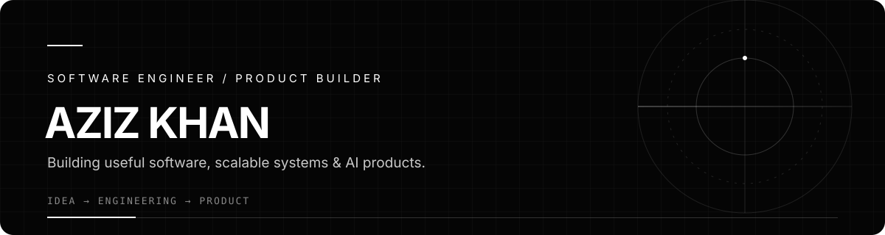

 

---

## About

I build software products, backend systems, and AI-powered applications — from early architecture and MVP development through production.

I enjoy solving practical engineering problems, shaping product ideas, and working with people who want to build useful things.

## Technologies

## Selected work

| Project | What it explores |
|:--|:--|
| [Uxlyze](https://github.com/s-azizkhan/uxlyze-next-web) | AI-assisted website experience analysis |
| [WishNex](https://github.com/s-azizkhan/WishNex) | Community-focused web product |
| [Zippy](https://github.com/s-azizkhan/zippy) · [Pavly](https://github.com/s-azizkhan/pavly) | Product experiments |
| [Foxly Flow](https://github.com/s-azizkhan/foxly-flow) · [FoxCOD](https://github.com/s-azizkhan/FoxCOD) | Software and tooling experiments |

## GitHub activity

 

## Let's build something

Open to meaningful engineering opportunities, technical partnerships, and conversations with founders building ambitious products.

Black & white. Focused on building.

